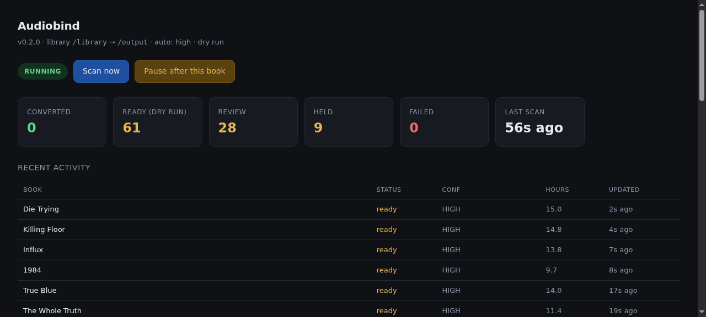

# Audiobind

**Fix an audiobook library instead of curating it by hand.**

Audiobind walks a folder of audiobooks, works out what each book actually is, merges the ones that
are spread over dozens of files into a single tagged `.m4b`, and files the result into a clean
`Author/Title` library. It is built for the mess every audiobook collection eventually becomes:
`Part 1`, `Disc 3`, `StoneColdUnabridgedPart2`, three copies of the same book, and a folder called
`Vince Flynn Novels 14 books Complete Collection`.

```
library-in/                         library-out/
  Michael Lewis- Moneyball/           Michael Lewis/
    Moneyball/                          Moneyball/
      1-01 1A.mp3  ... 195 files           Moneyball.m4b   (one file, 16 chapters, cover)
    Moneyball [Disc 2]/                    cover.jpg
    Moneyball [Disc 3]/                    metadata.json
```



## Status: beta — read this before you point it at your library

Audiobind is a **beta**: a solo project with a single front-end developer, and the
code is written with heavy AI assistance (designed, reviewed and tested by a human,
but not hand-written line by line). It reads real audiobook libraries and writes to
a separate output library, and software like that can fail badly — **you may
experience data loss**. Audiobind reads your source library and writes converted books
to a separate output folder; the only thing that ever *deletes* source files is the
explicit Delete button (typed confirmation, no undo). Keep backups, run it against a
copy first, and pin a tagged release instead of `latest` if reproducible behavior
matters to you.

## How it works

1. **Group parts into books.** `Book/Disc 1..9` and `Book/Part 1..3` collapse into one unit. A
   book is a *unit*, never a directory.
2. **Verify against the Audible catalog.** Title, author, narrator, series, ASIN - via the public
   Audible search API and Audnex. Every candidate is scored, and the winner must beat the best
   *different* work by a margin before it is trusted.
3. **Prove completeness.** The summed runtime of the parts is compared with the catalog runtime.
   A set that is an hour short is reported, not merged.
4. **Merge and convert.** One `ffmpeg` pass: concat demuxer, AAC, Audnex chapter marks scaled
   onto the real timeline, embedded cover, full tag set. The bitrate never drops below the
   configured floor (128 kbps by default) and a richer source keeps its own bitrate. A file that
   is already AAC in an MP4 container is remuxed with `-c:a copy` - no re-encode at all.
5. **File it.** `Author/Title/Title.m4b` or `Author/Series/03 - Title/Title.m4b`, plus a
   `cover.jpg` and an Audiobookshelf-compatible `metadata.json`.

### It is deliberately conservative

| Confidence | Meaning | Default behaviour |
|---|---|---|
| `HIGH` | title and author both corroborated, clear winner | converted |
| `MEDIUM` | exact title, author inferred from the catalog | converted (`AUTO_CONVERT=high` converts only HIGH) |
| `LOW` | weak or ambiguous match | left for review |
| `COLLECTION` | several books in one folder | left for review |
| held | runtime disagrees with the catalog by >25% - usually the wrong edition | not converted |

Converted books are written to the separate output library. The web UI's **Delete**
is the one destructive path — it permanently removes the source folder *and* the
published output, and requires typed confirmation. If you mount the library
read-only instead, Delete adapts: it removes the published output and forgets the
book, keeps the source folder untouched, and tells you so (the folder will
reappear on the next scan unless you remove it from the share).

Delete only removes what belongs to that one book. When two books' part folders share a
parent folder (`Author/Foo Part 1`, `Author/Bar Part 1`, ...), each book shows up on its own
row (`Author#foo`, `Author#bar`), and Delete removes only that book's part folders, never
the shared `Author` folder. If the folder you're deleting also holds another book's audio,
Delete refuses and nothing is removed.

## Installation

### Unraid (Community Applications)

Audiobind is pending publication in Community Applications. Until it is listed:

1. Copy the template into the Unraid template directory:
   ```bash
   cp templates/audiobind.xml /boot/config/plugins/dockerMan/templates-user/
   ```
2. In the Unraid web UI, go to **Apps** > **Settings** (gear icon) and check **"Allow install of second instance"**.
3. Click **Docker** > **Add Container** and select **audiobind** from the template dropdown.
4. Fill in the paths for your library (read-only), output directory, and appdata, then click **Apply**.

The template sets `PUID=99 PGID=100 --restart=unless-stopped` and exposes port 8080 for the web UI.

### Docker run

```bash
docker run -d \
  --name audiobind \
  --restart unless-stopped \
  -e PUID=99 \
  -e PGID=100 \
  -e AUDIO_BITRATE=128k \
  -e AUTO_CONVERT=high \
  -e SCAN_INTERVAL_MIN=30 \
  -e REGION=us \
  -e DRY_RUN=false \
  -v /path/to/audiobooks:/library:rw \
  -v /path/to/audiobooks-fixed:/output \
  -v /path/to/appdata/audiobind:/config \
  -p 8080:8080 \
  ghcr.io/stinger303/audiobind:0.12.0
```

### Docker Compose

```yaml
services:
  audiobind:
    image: ghcr.io/stinger303/audiobind:0.12.0
    restart: unless-stopped
    environment:
      - PUID=99
      - PGID=100
      - AUDIO_BITRATE=128k
      - AUTO_CONVERT=high
      - SCAN_INTERVAL_MIN=30
      - REGION=us
      - DRY_RUN=false
    volumes:
      - /path/to/audiobooks:/library:rw
      - /path/to/audiobooks-fixed:/output
      - /path/to/appdata/audiobind:/config
    ports:
      - "8080:8080"
```

### First run

Open `http://<host>:8080` for the status page. Books are discovered on the first scan (within `SCAN_INTERVAL_MIN` minutes). Review and held books need attention in the sidebar — you decide what to convert. See the [CHANGELOG](CHANGELOG.md) for what changed in each release.

## Controls in the web UI

The status page is also the control panel:

| Button | What it does |
|---|---|
| **Scan now** | skips the interval and starts a pass immediately |
| **Pause after this book** | finishes the book in flight, then stops before starting another |
| **Resume** | continues, and scans immediately |
| **Dry run: ON / OFF** | switches between deciding-only and writing. Persisted, so a restart keeps your choice; `DRY_RUN` is only the default for a fresh install |

Both toggles survive container restarts. Scripted equivalent:

```bash
curl -X POST -H 'Content-Type: application/json' -d '{"action":"pause"}'    localhost:8080/api/control
curl -X POST -H 'Content-Type: application/json' -d '{"action":"resume"}'   localhost:8080/api/control
curl -X POST -H 'Content-Type: application/json' -d '{"action":"scan"}'     localhost:8080/api/control
curl -X POST -H 'Content-Type: application/json' -d '{"action":"dry_run","value":false}' localhost:8080/api/control
```

Every POST must be sent as `Content-Type: application/json` (anything else gets a 415).
If the request carries an `Origin` or `Referer` header, it has to name this server's own
host, or `X-Forwarded-Host` when you're behind a reverse proxy. Anything else gets a 403. That
stops another website you visit from pressing these buttons for you. Scripts that send
neither header, like the `curl` lines above, keep working. There is no login, so keep the
port on your LAN.

### Series

The **Series** tab (`/series`) lists every series where you have two or more books.
Each one is checked against the Audible series order and shows what you're missing. The
amber number on the tab is the total missing across every series whose size Audible
reported. **I have this** marks a book you own without a rip, so it stops counting as
missing. **Copy Audible link** copies the book's Audible page address. Series lists are
fetched in the background, at most once a day per series. `/api/series` returns the same
data as JSON.

### CLI

```bash
docker exec audiobind audiobind audit              # report only, writes /config/audit.csv
docker exec audiobind audiobind scan               # one pass, convert what is safe
docker exec audiobind audiobind convert --unit "Michael Lewis- Moneyball"
docker exec audiobind audiobind daemon             # the default: scan forever
docker exec audiobind audiobind health             # exit 0 while the daemon is alive
```

## Configuration

| Variable | Default | Description |
|---|---|---|
| `LIBRARY_ROOT` | `/library` | Source library (writable so Delete can fully remove a book) |
| `OUTPUT_ROOT` | `/output` | Where finished books go |
| `STATE_DIR` | `/config` | SQLite manifest + `audit.csv` |
| `AUTO_CONVERT` | `high` | `high`, `medium` or `off` |
| `SCAN_INTERVAL_MIN` | `30` | Poll interval |
| `AUDIO_BITRATE` | `128k` | Minimum AAC bitrate. A source that is already richer keeps its own bitrate (256k mp3 stays 256k); everything is capped at 320k |
| `AUDIO_CHANNELS` | `1` | 1 = mono |
| `SAMPLE_RATE` | `44100` | Output sample rate |
| `JOBS` | `1` | Books converted in parallel |
| `NICE` | `10` | ffmpeg CPU priority |
| `MAX_RUNTIME_DELTA` | `0.25` | Hold when runtime differs by more than this fraction |
| `REGION` | `us` | Audible region (`us`, `ca`, `uk`, `au`, `fr`, `de`, `it`, `es`, `jp`, `in`) |
| `DRY_RUN` | `false` | Decide and log, write nothing |
| `WEB_ENABLED` | `true` | Status page |
| `WEB_PORT` | `8080` | Status page port |
| `ALLOWED_HOSTS` | `localhost,127.0.0.1` | Comma-separated host names / IPs the web UI answers to (ports are ignored). **Add the LAN IP and hostname you browse to**, e.g. `192.168.1.10,tower,tower.local`; any other `Host` gets a 403. This blocks DNS-rebinding attacks from websites you visit |
| `TRUSTED_PROXY` | `false` | `true` only behind your own reverse proxy: `X-Forwarded-Host` is then checked against `ALLOWED_HOSTS` instead of `Host` |
| `NOTIFY_URL` | | Optional webhook for a per-scan summary |
| `PUID` / `PGID` | `99` / `100` | Ownership of written files |

## Notes on correctness

* **`+use_metadata_tags` must never be added to the ffmpeg command.** It makes the MP4 muxer drop
  the attached cover art while still exiting 0. `encode.py` verifies the output has a stream with
  `attached_pic=1` before publishing, precisely because of this.
* **Audnex chapters are camelCase** (`lengthMs`, `startOffsetMs`). Reading `length_ms` yields zero
  for every chapter and silently falls back to per-file chapters.
* **Chapter timings are only trusted when they fit.** Audnex timings are scaled onto the real
  duration only if `local / catalog` is within 0.85-1.20; otherwise per-file chapters are used,
  because the catalog entry is for a different edition.
* **Audiobookshelf rewrites `metadata.json`** when it scans the new book. Losing our extra
  `duration` key is the app adopting the book, not a failed write.

## Development

```bash
python -m unittest discover -s tests -v
docker build -t audiobind:dev .
```

## License

MIT - see [LICENSE](LICENSE).