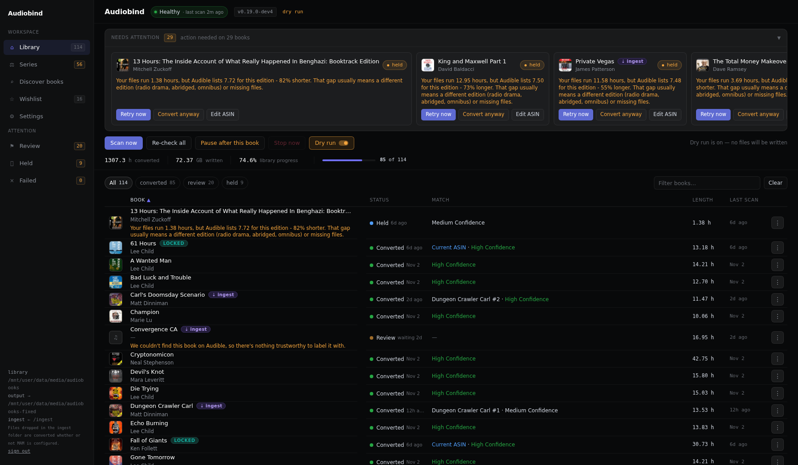

# Audiobind

**Fix an audiobook library instead of curating it by hand.**

Audiobind walks a folder of audiobooks, works out what each book actually is, merges the ones that
are spread over dozens of files into a single tagged `.m4b`, and files the result into a clean
`Author/Title` library. It is built for the mess every audiobook collection eventually becomes:
`Part 1`, `Disc 3`, `StoneColdUnabridgedPart2`, three copies of the same book, and a folder called
`Vince Flynn Novels 14 books Complete Collection`.

## What you get

- One `.m4b` per book, with the Audnex chapter marks, the full tag set and an embedded cover.
- Every book checked against the Audible catalog. A winner must beat the best different work by
  a margin, and knockoffs (summaries, study guides, zero-runtime stubs) never count against it.
- A completeness check: a set whose runtime is an hour short of the catalog is reported, not merged.
- Optional single-file MP3 output (`OUTPUT_FORMAT`) with ID3 chapters, cover and tags, alone or
  next to the `.m4b`.
- Optional wishlist acquisition from a private tracker you configure, through qBittorrent. Off unless the `TRACKER_*` settings are complete.
- **Discover books**: search the catalog, plus suggestions based on the authors, narrators and
  genres you already own.
- Series completion: the **Series** page shows what you are missing, and **Want all missing**
  puts it on the wishlist in one click.
- Conversion never changes or deletes your source files. Only the explicit **Delete** button does,
  and a read-only `/library` mount rules even that out.
- A dry run that decides and logs everything and writes nothing.
- One container, Python standard library only, no telemetry, no external database (state is a
  SQLite file under `/config`).

## Requirements

- Docker (or Unraid). Nothing else to install: ffmpeg is in the image.
- Optional, for wishlist acquisition only: an account on a private tracker (and a VPN container if you
  want tracker traffic kept off your home connection) and qBittorrent for the downloads.

**Quick start:** the three mounts (`/library`, `/output`, `/config`), `ALLOWED_HOSTS` and the
account must be right before the first scan - the [First run](docs/install.md#first-run)
checklist walks through them in order.

```
library-in/                         library-out/
  Michael Lewis- Moneyball/           Michael Lewis/
    Moneyball/                          Moneyball/
      1-01 1A.mp3  ... 195 files           Moneyball.m4b   (one file, 16 chapters, cover)
    Moneyball [Disc 2]/                    cover.jpg
    Moneyball [Disc 3]/                    metadata.json
```



## Status: beta — read this before you point it at your library

Audiobind is a **beta**: a solo project with a single front-end developer, and the
code is written with heavy AI assistance (designed, reviewed and tested by a human,
but not hand-written line by line). It reads real audiobook libraries and writes to
a separate output library, and software like that can fail badly — **you may
experience data loss**. Audiobind reads your source library and writes converted books
to a separate output folder; the only thing that ever *deletes* source files is the
explicit Delete button (a confirmation dialog, no undo). Keep backups, run it against a
copy first, and pin a tagged release instead of `latest` if reproducible behavior
matters to you.

## How it works

1. **Group parts into books.** `Book/Disc 1..9` and `Book/Part 1..3` collapse into one unit. A
   book is a *unit*, never a directory.
2. **Verify against the Audible catalog.** Title, author, narrator, series, ASIN - via the public
   Audible search API and Audnex. Every candidate is scored, and the winner must beat the best
   *different* work by a margin before it is trusted. Knockoffs (summaries, reviews, study
   guides, zero-runtime stubs) never count against that margin, and when two candidates are
   neck and neck the one Audnex agrees with wins.
3. **Prove completeness.** The summed runtime of the parts is compared with the catalog runtime.
   A set that is an hour short is reported, not merged.
4. **Merge and convert.** One `ffmpeg` pass: concat demuxer, AAC, Audnex chapter marks scaled
   onto the real timeline, embedded cover, full tag set. The bitrate never drops below the
   configured floor (128 kbps by default) and a richer source keeps its own bitrate. A file that
   is already AAC in an MP4 container is remuxed with `-c:a copy` - no re-encode at all.
5. **File it.** In the Audiobookshelf layout: `Author/Title/Title.m4b` or
   `Author/Series/3 - Title/Title.m4b`, plus a `cover.jpg` and an Audiobookshelf-compatible
   `metadata.json`. See [Folder layout](docs/configuration.md#folder-layout).

### It is deliberately conservative

| Confidence | Meaning | Default behaviour |
|---|---|---|
| `HIGH` | title and author both corroborated, clear winner | converted |
| `MEDIUM` | exact title, author inferred from the catalog | converted (`AUTO_CONVERT=high` converts only HIGH) |
| `LOW` | weak or ambiguous match | left for review |
| `COLLECTION` | several books in one folder | left for review |
| held | runtime disagrees with the catalog by >25% - usually the wrong edition | not converted |

Converted books are written to the separate output library. The web UI's **Delete**
is the one destructive path — it permanently removes the source folder *and* the
published output, after you confirm in a dialog (one **Delete permanently** button; there is
no typed confirmation, so read the dialog). It only removes an output folder Audiobind itself
converted: a book marked *already published* points at a folder that was there before, and
Delete forgets the book but leaves that folder alone. If you mount the library
read-only instead, Delete adapts: it removes the published output and forgets the
book, keeps the source folder untouched, and tells you so (the folder will
reappear on the next scan unless you remove it from the share).

Delete only removes what belongs to that one book. When two books' part folders share a
parent folder (`Author/Foo Part 1`, `Author/Bar Part 1`, ...), each book shows up on its own
row (`Author#foo`, `Author#bar`), and Delete removes only that book's part folders, never
the shared `Author` folder. If the folder you're deleting also holds another book's audio,
Delete refuses and nothing is removed.

## Documentation

- [Installation and first run](docs/install.md) - Unraid, docker, compose, hardening, a reverse proxy, the first account, signing in.
- [Using Audiobind](docs/using.md) - the web UI controls, the Series page, Discover books and the wishlist, the CLI.
- [Configuration](docs/configuration.md) - every environment variable with its default, and the output formats (M4B, MP3, both).
- [Acquisition](docs/acquisition.md) - bring your own downloader, the optional private-tracker wishlist watcher, running it through a VPN.
- [Development](docs/development.md) - running the tests and building the image, and the correctness traps in the encoder.
- [SECURITY.md](SECURITY.md) - how to report a vulnerability privately, and what is in and out of scope.
- [CHANGELOG.md](CHANGELOG.md) - what changed in each release.

## License

MIT - see [LICENSE](LICENSE).