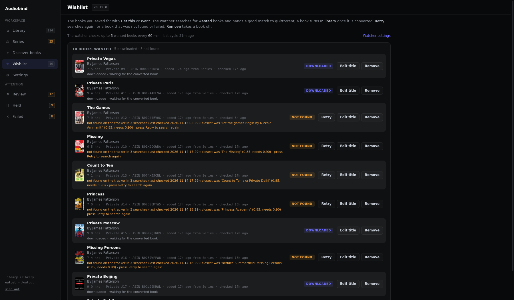
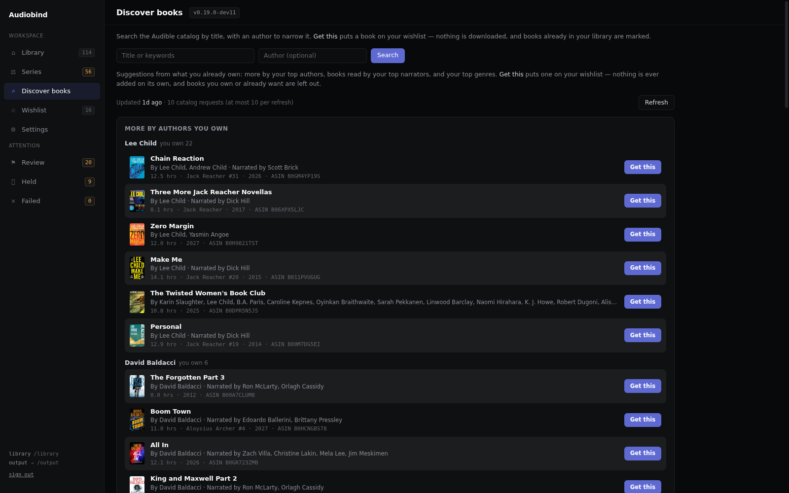

# Audiobind

**Fix an audiobook library instead of curating it by hand.**

Audiobind walks a folder of audiobooks, works out what each book actually is, merges the ones that
are spread over dozens of files into a single tagged `.m4b`, and files the result into a clean
`Author/Title` library. It is built for the mess every audiobook collection eventually becomes:
`Part 1`, `Disc 3`, `StoneColdUnabridgedPart2`, three copies of the same book, and a folder called
`Vince Flynn Novels 14 books Complete Collection`.

## What you get

- One `.m4b` per book, with the Audnex chapter marks, the full tag set and an embedded cover.
- Every book checked against the Audible catalog. A winner must beat the best different work by
  a margin, and knockoffs (summaries, study guides, zero-runtime stubs) never count against it.
- A completeness check: a set whose runtime is an hour short of the catalog is reported, not merged.
- Optional single-file MP3 output (`OUTPUT_FORMAT`) with ID3 chapters, cover and tags, alone or
  next to the `.m4b`.
- Optional wishlist acquisition from a private tracker you configure, through qBittorrent. Off unless the `TRACKER_*` settings are complete.
- **Discover books**: search the catalog, plus suggestions based on the authors, narrators and
  genres you already own.
- Series completion: the **Series** page shows what you are missing, and **Want all missing**
  puts it on the wishlist in one click.
- Conversion never changes or deletes your source files. Only the explicit **Delete** button does,
  and a read-only `/library` mount rules even that out.
- A dry run that decides and logs everything and writes nothing.
- One container, Python standard library only, no telemetry, no external database (state is a
  SQLite file under `/config`).

## Requirements

- Docker (or Unraid). Nothing else to install: ffmpeg is in the image.
- Optional, for wishlist acquisition only: an account on a private tracker (and a VPN container if you
  want tracker traffic kept off your home connection) and qBittorrent for the downloads.

```
library-in/                         library-out/
  Michael Lewis- Moneyball/           Michael Lewis/
    Moneyball/                          Moneyball/
      1-01 1A.mp3  ... 195 files           Moneyball.m4b   (one file, 16 chapters, cover)
    Moneyball [Disc 2]/                    cover.jpg
    Moneyball [Disc 3]/                    metadata.json
```


## Status: beta — read this before you point it at your library

Audiobind is a **beta**: a solo project with a single front-end developer, and the
code is written with heavy AI assistance (designed, reviewed and tested by a human,
but not hand-written line by line). It reads real audiobook libraries and writes to
a separate output library, and software like that can fail badly — **you may
experience data loss**. Audiobind reads your source library and writes converted books
to a separate output folder; the only thing that ever *deletes* source files is the
explicit Delete button (typed confirmation, no undo). Keep backups, run it against a
copy first, and pin a tagged release instead of `latest` if reproducible behavior
matters to you.

## How it works

1. **Group parts into books.** `Book/Disc 1..9` and `Book/Part 1..3` collapse into one unit. A
   book is a *unit*, never a directory.
2. **Verify against the Audible catalog.** Title, author, narrator, series, ASIN - via the public
   Audible search API and Audnex. Every candidate is scored, and the winner must beat the best
   *different* work by a margin before it is trusted. Knockoffs (summaries, reviews, study
   guides, zero-runtime stubs) never count against that margin, and when two candidates are
   neck and neck the one Audnex agrees with wins.
3. **Prove completeness.** The summed runtime of the parts is compared with the catalog runtime.
   A set that is an hour short is reported, not merged.
4. **Merge and convert.** One `ffmpeg` pass: concat demuxer, AAC, Audnex chapter marks scaled
   onto the real timeline, embedded cover, full tag set. The bitrate never drops below the
   configured floor (128 kbps by default) and a richer source keeps its own bitrate. A file that
   is already AAC in an MP4 container is remuxed with `-c:a copy` - no re-encode at all.
5. **File it.** `Author/Title/Title.m4b` or `Author/Series/03 - Title/Title.m4b`, plus a
   `cover.jpg` and an Audiobookshelf-compatible `metadata.json`.

### It is deliberately conservative

| Confidence | Meaning | Default behaviour |
|---|---|---|
| `HIGH` | title and author both corroborated, clear winner | converted |
| `MEDIUM` | exact title, author inferred from the catalog | converted (`AUTO_CONVERT=high` converts only HIGH) |
| `LOW` | weak or ambiguous match | left for review |
| `COLLECTION` | several books in one folder | left for review |
| held | runtime disagrees with the catalog by >25% - usually the wrong edition | not converted |

Converted books are written to the separate output library. The web UI's **Delete**
is the one destructive path — it permanently removes the source folder *and* the
published output, and requires typed confirmation. If you mount the library
read-only instead, Delete adapts: it removes the published output and forgets the
book, keeps the source folder untouched, and tells you so (the folder will
reappear on the next scan unless you remove it from the share).

Delete only removes what belongs to that one book. When two books' part folders share a
parent folder (`Author/Foo Part 1`, `Author/Bar Part 1`, ...), each book shows up on its own
row (`Author#foo`, `Author#bar`), and Delete removes only that book's part folders, never
the shared `Author` folder. If the folder you're deleting also holds another book's audio,
Delete refuses and nothing is removed.

## Installation

### Unraid (Community Applications)

Audiobind is pending publication in Community Applications. Until it is listed:

1. Copy the template into the Unraid template directory:
   ```bash
   cp templates/audiobind.xml /boot/config/plugins/dockerMan/templates-user/
   ```
2. In the Unraid web UI, go to **Apps** > **Settings** (gear icon) and check **"Allow install of second instance"**.
3. Click **Docker** > **Add Container** and select **audiobind** from the template dropdown.
4. Fill in the paths for your library (read-only), output directory, and appdata, then click **Apply**.

The template sets `PUID=99 PGID=100`, runs the container hardened (`--read-only --tmpfs /tmp
--cap-drop ALL --cap-add CHOWN --cap-add SETUID --cap-add SETGID
--security-opt no-new-privileges:true`) and exposes port 8080 for the web UI. Set
**Allowed hosts** to your server's LAN IP / hostname, or the UI only answers on the server
itself.

### Docker run

```bash
docker run -d \
  --name audiobind \
  --restart unless-stopped \
  -e PUID=99 \
  -e PGID=100 \
  -e AUDIO_BITRATE=128k \
  -e AUTO_CONVERT=high \
  -e SCAN_INTERVAL_MIN=30 \
  -e REGION=us \
  -e DRY_RUN=false \
  -e ALLOWED_HOSTS=localhost,127.0.0.1,192.168.1.10,tower.local \
  --read-only --tmpfs /tmp \
  --cap-drop ALL --cap-add CHOWN --cap-add SETUID --cap-add SETGID \
  --security-opt no-new-privileges:true \
  -v /path/to/audiobooks:/library:rw \
  -v /path/to/audiobooks-fixed:/output \
  -v /path/to/appdata/audiobind:/config \
  -p 8080:8080 \
  ghcr.io/stinger303/audiobind:latest
```

### Docker Compose

```yaml
services:
  audiobind:
    image: ghcr.io/stinger303/audiobind:latest
    restart: unless-stopped
    environment:
      - PUID=99
      - PGID=100
      - AUDIO_BITRATE=128k
      - AUTO_CONVERT=high
      - SCAN_INTERVAL_MIN=30
      - REGION=us
      - DRY_RUN=false
      - ALLOWED_HOSTS=localhost,127.0.0.1,192.168.1.10,tower.local
    read_only: true
    tmpfs:
      - /tmp
    cap_drop: [ALL]
    cap_add: [CHOWN, SETUID, SETGID]
    security_opt:
      - no-new-privileges:true
    volumes:
      - /path/to/audiobooks:/library:rw
      # - /path/to/audiobooks:/library:ro   # safer, but Delete can then no longer remove sources
      - /path/to/audiobooks-fixed:/output
      - /path/to/appdata/audiobind:/config
    ports:
      - "8080:8080"
```

### Hardening

The examples above run the container with a read-only root filesystem (`/tmp` is a
tmpfs; the app itself only writes to `/config`, `/output` and - for Delete -
`/library`), every Linux capability dropped except the three the entrypoint needs
to hand the files to `PUID`/`PGID` (`CHOWN`, `SETUID`, `SETGID`; the app runs
without any), and `no-new-privileges`. Audiobind feeds media from your library to
ffmpeg, and those files may come from anywhere, so these limits keep a malicious
file's reach small. `:latest` is rebuilt every week (no build cache) so it picks up
ffmpeg and base-image security patches. Version tags stay exactly as released: pin
one for reproducible installs and move to the next release for patches.

**Library mount: your call.** Mounting `/library` read-only (`:ro`) means Audiobind
can never change or delete your sources, at the cost of Delete no longer removing
the source folder (it still removes the output and forgets the book). Writable
(`:rw`) lets Delete remove sources too.

### Behind a reverse proxy

Only if you put Audiobind behind your own reverse proxy (for TLS, say), set both:

```bash
-e TRUSTED_PROXY=true \
-e TRUSTED_PROXY_IPS=172.18.0.0/16      # the proxy's address(es) as Audiobind sees them
```

`X-Forwarded-Host`, `-For` and `-Proto` are then believed, but **only from the peers listed in
`TRUSTED_PROXY_IPS`** (IPs or CIDRs); a forwarded header from any other peer is ignored. Since
0.19.0-dev5, `TRUSTED_PROXY=true` on its own trusts nobody. **If you already had
`TRUSTED_PROXY=true`, add `TRUSTED_PROXY_IPS` when you upgrade**, or your proxy's headers stop being
honoured (the plain `Host` header is checked against `ALLOWED_HOSTS` instead, and the session cookie
does not get `Secure` over https). Without a proxy, leave both unset. Audiobind is meant for your LAN: do
not expose it to the internet without a reverse proxy and TLS (see [SECURITY.md](SECURITY.md)).

### First run

Open `http://<host>:8080`. The first time, Audiobind asks you to **create your account**:
a username (1-64 characters) and a password (at least 8 characters, typed twice). There is
exactly one account; once it exists the setup page is gone for good, and every page and
API call needs you signed in. Until then nothing but the setup page answers, so do this
right after you start the container, from your own network.

Then you get the status page. Books are discovered on the first scan (within `SCAN_INTERVAL_MIN` minutes). Review and held books need attention in the sidebar — you decide what to convert. See the [CHANGELOG](CHANGELOG.md) for what changed in each release.

### Signing in

On the first start nobody has an account yet, so the first visit opens a setup page - and until someone finishes it, anyone who can reach the port can create the account. Open the page and complete setup right after starting the container.

`/healthz` is the one public endpoint, with or without an account: it needs no sign-in, so an
uptime monitor can poll it, and it only ever answers `ok` (200) or `stale` (503; the scan loop has
not checked in for longer than about 2.5 scan intervals plus five minutes). Every other page and
API call needs the account.

* **Browser:** username and password on the sign-in page. A session lasts 7 days
  (`HttpOnly`, `SameSite=Strict` cookie). Tick **Keep me signed in for 30 days** to make that
  browser's session last 30 days instead (it is unticked by default; leave it off on a shared
  computer). Sessions are saved in the state database, so a restart or redeploy does not
  sign you out. Only a hash of each session id is stored. Changing the password or username
  still ends every other session. Five failed sign-ins from one IP lock that IP out
  for 10 minutes. A wrong username and a wrong password get the same answer.
* **Remembered username:** after a successful sign-in the browser keeps a small `ab_user`
  cookie (30 days, `HttpOnly`, `SameSite=Strict`) that only pre-fills the username box. It is
  a convenience, never a credential: a request carrying just that cookie is still signed out.
  Signing out keeps it.
* **Scripts:** send the account password as a Bearer token:
  `curl -H "Authorization: Bearer $AUDIOBIND_PASSWORD" localhost:8080/api/state`. Wrong
  passwords count towards the same lockout.
* **Change the password or username** in **Settings → Account**. Both need the current
  password. The browser you change it from stays signed in. Every other browser is
  signed out.
* The password is stored only as a salted PBKDF2-SHA256 hash (600,000 rounds) in the state
  database under `/config`. It is never logged.

**Forgot the password?** There is no reset link, on purpose. Reset it from a shell on the
server instead:

```bash
docker exec -it audiobind audiobind reset-password
```

It asks for a username (Enter keeps the current one) and the new password, typed twice and
hidden. Whatever account existed is replaced, and every browser is signed out. On a fresh
database it creates the account instead. `--username NAME` skips the username question.
Without a terminal (no `-it`) it refuses unless you pass `--username`, so a script can't
wipe your sign-in by accident. In that case the new password is read from the first line of
stdin: `printf '%s\n' "$NEW" | docker exec -i audiobind audiobind reset-password --username me`.

**Upgrading from `AUTH_TOKEN`:** existing installs keep working. While `AUTH_TOKEN` is set
and no account exists, the setup page is skipped. You sign in with any username (for example
`admin`) and the token as the password, and `Bearer <token>` still works for scripts. Create
the account in **Settings → Account** (it asks for the token to confirm) or with
`reset-password`. From then on the account is the only way in: `AUTH_TOKEN` stops working
and you can remove it.

## Controls in the web UI

The status page is also the control panel:

| Button | What it does |
|---|---|
| **Scan now** | skips the interval and starts a pass immediately |
| **Pause after this book** | finishes the book in flight, then stops before starting another |
| **Resume** | continues, and scans immediately |
| **Dry run: ON / OFF** | switches between deciding-only and writing. Persisted, so a restart keeps your choice; `DRY_RUN=true` always starts dry, whatever was saved (the switch can turn it off afterwards), while `DRY_RUN=false` leaves the saved choice in charge |

Both toggles survive container restarts. Scripted equivalent:

```bash
AUTH="Authorization: Bearer $AUDIOBIND_PASSWORD"
curl -X POST -H "$AUTH" -H 'Content-Type: application/json' -d '{"action":"pause"}'    localhost:8080/api/control
curl -X POST -H "$AUTH" -H 'Content-Type: application/json' -d '{"action":"resume"}'   localhost:8080/api/control
curl -X POST -H "$AUTH" -H 'Content-Type: application/json' -d '{"action":"scan"}'     localhost:8080/api/control
curl -X POST -H "$AUTH" -H 'Content-Type: application/json' -d '{"action":"dry_run","value":false}' localhost:8080/api/control
```

Every POST must be sent as `Content-Type: application/json` (anything else gets a 415).
If the request carries an `Origin` or `Referer` header, it has to name this server's own
host, or `X-Forwarded-Host` when you're behind a reverse proxy. Anything else gets a 403. That
stops another website you visit from pressing these buttons for you. Scripts that send
neither header, like the `curl` lines above, keep working. They still need the Bearer
password (see [Signing in](#signing-in)). Keep the port on your LAN all the same.

### Series

The **Series** tab (`/series`) lists every series where you have two or more books.
Each one is checked against the Audible series order and shows what you're missing. The
amber number on the tab is the total missing across every series whose size Audible
reported. **I have this** marks a book you own without a rip, so it stops counting as
missing. **Copy Audible link** copies the book's Audible page address. Series lists are
fetched in the background, at most once a day per series. `/api/series` returns the same
data as JSON.

Each card shows "owned X of Y" and notes that the total comes from the Audible catalog, with
when it was checked. Audiobind never estimates a total. If Audible has no listing, or the
catalog couldn't be reached, the card shows **total unknown** and the reason. In the missing
list, **Want** puts one book on your wishlist. **Want all missing** adds every missing book in
the series in one click. Books already on the wishlist are skipped, and nothing is downloaded.
Want all uses the server's current missing list, so a book you got after the page loaded isn't
added.

```bash
curl -X POST -H "$AUTH" -H 'Content-Type: application/json' \
     -d '{"series":"jack-reacher","missing":"all"}' localhost:8080/api/wishlist
```

### Discover and the wishlist

**Discover books** (`/discover`) is one screen: a search box on top and, below it, the
recommended books. Searching shows the results on the same page in place of the
recommendations; clearing the query brings the recommendations back. The search form takes a
title, with an optional author. Each result shows its cover, authors, narrators, runtime, series and release year.
Books already in your library are marked **In your library**: same ASIN, same title and
author, or marked "I have this" on the Series page. **Get this** puts a book on your
wishlist. That's all it does: nothing is downloaded, and no tracker is contacted. The
[wishlist watcher](#the-wishlist-watcher-private-tracker) picks books up from there when it is
on. The **Wishlist** tab (`/wishlist`, right below Discover books in the rail, watcher only) lists it with
each book's state and when it was last checked; **Retry** and **Remove** act on one book. The number
on the Wishlist tab is the wishlist size.



A wishlist row moves through these states: **wanted** → **downloading** (sent to qBittorrent) →
**downloaded** (the torrent finished; the book is waiting to be converted). The row is **removed**
when the converted book appears in your library (a want-list holds nothing you already have). A book
that is in your library already is taken off the list the same way, whatever its state. **not
found** and **error** rows stay until you press **Retry** or **Remove**.

**Edit title** gives a book its own *search title*. The watcher searches the tracker for that title
instead of the catalog one, and the match has to clear the same 0.90 title score against it. Use
it when a book comes back *not found* with a note like `closest was 'The Missing' (0.85, needs
0.90)`: the catalog calls it `Missing`, the tracker calls it `The Missing`, so type the tracker's title. Saving
puts the book back to *wanted* with its note and miss count cleared, so the next cycle searches
it at once; the row keeps its catalog title and shows `searching for "..."` while an override is
set. Saving a blank title clears the override. Search uses
one catalog request at a time, with the same pacing as matching, and only the US store
(`api.audible.com`).

```bash
curl -H "$AUTH" 'localhost:8080/api/discover/search?title=project+hail+mary&author=weir'
curl -H "$AUTH" localhost:8080/api/wishlist
curl -X POST -H "$AUTH" -H 'Content-Type: application/json' -d '{"asin":"B08G9PRS1K"}' localhost:8080/api/wishlist
curl -X POST -H "$AUTH" -H 'Content-Type: application/json' -d '{"asin":"B08G9PRS1K"}' localhost:8080/api/wishlist/remove
```

Adding an ASIN that's already on the list changes nothing. If Audiobind has never shown an
ASIN (in a search, a suggestion or a series), send `"title"` (and `"authors"`) with it.

The recommendations on Discover books suggest books based on what you already own. They have
three sections: more by your top 5 authors, books read by your top 3 narrators, and your top 2
genres. Genres come from the `metadata.json` written beside each published book. Books you own
or already want are left out, and so are summaries and other knockoffs. Suggestions are stored,
so opening the page doesn't query the catalog. A refresh runs when nothing is stored yet, when
the stored suggestions are more than 7 days old, or when you press **Refresh**. One refresh
makes at most 10 catalog requests (one per author, narrator and genre). Nothing goes on the
wishlist until you press **Get this**.



```bash
curl -H "$AUTH" localhost:8080/api/discover/recommendations          # stored result only
curl -X POST -H "$AUTH" -H 'Content-Type: application/json' \
     -d '{"action":"refresh","force":true}' localhost:8080/api/discover/recommendations
```

### Bring your own downloader

Audiobind is a library fixer first. Any tool that writes **completed** audiobook files into the
ingest folder works: qBittorrent, SABnzbd, Readarr, a manual copy, a synced folder. Mount that
folder and point `INGEST_DIR` at it:

```bash
  -v /mnt/user/downloads/audiobooks:/ingest:ro \
  -e INGEST_DIR=/ingest
```

The one rule: files must be complete before they land in the folder (move them in when
finished, or use the downloader's "completed" folder), or the app may see a partial book.
Wishlist acquisition (below) is optional; everything else works the same without it.

### The wishlist watcher (private tracker)

Optional, and off by default. Audiobind does not know which site it talks to: you tell it the
site's URL, the path of its JSON search endpoint, the path of its torrent download endpoint and
the JSON document its search expects, and the name and value of its session cookie. Until all six are set (and `QBIT_USER` / `QBIT_PASS`
for the qBittorrent WebUI) the watcher is off: no thread, no network, and Settings > Watcher
names what is still missing.

| Variable | Default | Meaning |
|---|---|---|
| `TRACKER_URL` | *(unset)* | **Required.** Base URL, e.g. `https://tracker.example`. No path, query or login; a malformed value stops startup |
| `TRACKER_SEARCH_PATH` | *(unset)* | **Required.** Path of the JSON search endpoint |
| `TRACKER_SEARCH_METHOD` | `POST` | `POST` or `GET` |
| `TRACKER_SEARCH_ENCODING` | `json` | `json` or `form`: how a `POST` sends the search body (see below) |
| `TRACKER_SEARCH_BODY` | *(unset)* | **Required, no default.** The search request as a JSON object with `{{title}}`, `{{author}}` and `{{category}}` placeholders (see below) |
| `TRACKER_SEARCH_CATEGORY` | *(unset)* | The value `{{category}}` stands for, if the site needs one |
| `TRACKER_DOWNLOAD_PATH` | *(unset)* | **Required.** Path of the torrent download endpoint |
| `TRACKER_DOWNLOAD_PARAM` | `tid` | Query parameter carrying the torrent id |
| `TRACKER_FREELEECH_PARAM` | *(unset)* | Query parameter that spends a freeleech credit, e.g. `fl`. Empty = never sent |
| `TRACKER_COOKIE_NAME` | *(unset)* | **Required.** The session cookie's name |
| `TRACKER_SESSION` | *(unset)* | **Required.** The session cookie's value. A secret - never shown in the UI, the API or the log |

`TRACKER_SEARCH_BODY` is the document sent to the search endpoint, for example
`{"q": "{{title}} {{author}}"}`. `{{title}}` and `{{author}}` are replaced with the wanted book's
title and first author, `{{category}}` with `TRACKER_SEARCH_CATEGORY`. Values are JSON-escaped, so a
quote in a title cannot break the document. **Empty-value rule:** an object member or list item whose
value is nothing but placeholders and comes out empty (a book without an author, an unset category) is
left out of the document; a string that mixes text and placeholders is trimmed. With `POST` and
`TRACKER_SEARCH_ENCODING=json` (the default) the document is sent as a JSON body. With
`TRACKER_SEARCH_ENCODING=form` it is sent as `application/x-www-form-urlencoded` fields, as is a
`GET` (as query parameters): a string is sent as-is, a list repeats its key once per item, a nested
object becomes `key[sub]`, booleans are `true` / `false`, numbers their decimal form and `null` is
dropped. Keys are not re-encoded beyond normal urlencoding, so `tor[text]` is sent as `tor%5Btext%5D`.
A form example (a fictional site):

```
TRACKER_SEARCH_ENCODING=form
TRACKER_SEARCH_BODY={"tor[text]": "{{title}}", "tor[author]": "{{author}}", "tor[searchIn]": "torrents", "tor[browse_lang][]": ["english"], "perpage": 25}
```

sends `tor%5Btext%5D=Dune&tor%5Bauthor%5D=Frank+Herbert&tor%5BsearchIn%5D=torrents&tor%5Bbrowse_lang%5D%5B%5D=english&perpage=25`
(a book without an author sends no `tor[author]` at all). Anything else the site needs - a page size, a
language filter, a sort order - goes into your template as a literal member.

The six settings that existed before this naming (session, membership, proxy, user agent and the two
IP guards) still work under their old variable names when the new name is empty (one deprecation line in the log
at startup, never the value); the new name wins when both are set. The paths, cookie name, search body and
category have no old name - set them.

With the settings in place, a background thread works through the wishlist every
`WATCH_INTERVAL_MIN` minutes (the interval and the books-per-cycle cap are editable in
**Settings > Watcher**; the env vars are the defaults, and a saved value applies from the next
cycle with no restart):

1. Books already in your library (a converted book with the same ASIN, or the same title and
   author) are removed from the wishlist - this also runs after every scan, watcher or not.
2. Up to `WATCH_MAX_PER_CYCLE` **wanted** books - never-checked first, oldest first, then the
   least recently checked - are searched on the tracker's JSON search endpoint. Before any
   search, if `WATCH_MAX_INCOMPLETE` (default 10) torrents in your qBittorrent category are still
   downloading, the cycle holds: nothing is searched or added, and one line says so. `0` turns this
   off. It never delays the **downloaded** flip or the library match.
3. No good match (title similarity 0.90+, an author match, audio files, not already snatched):
   the book stays **wanted** with a "not found on the tracker (checked ...)" note and is searched
   again later; after 3 misses in a row it becomes **not found** until you press **Retry**. A poor
   match is never forced.
4. A match: the torrent is downloaded through the download endpoint and handed to
   qBittorrent (category `QBIT_CATEGORY`, default `audiobooks`, whose save path is your ingest folder). It is
   downloaded **without** a freeleech credit when it is already free, freeleech for your account
   or a personal freeleech, and **with** one (`TRACKER_FREELEECH_PARAM`) otherwise - the decision
   is written in the book's note. The book becomes **downloading**, then **downloaded** once the
   torrent finishes in qBittorrent, and its row is removed once ingest has converted it and the
   book is in your library.

The watcher only ever calls the two configured endpoints, never parses HTML and never follows a
redirect. It sends one request at a time, at least 3 s apart, and after any error it backs off
(60 s, doubling to 30 minutes) and ends the cycle. A failed download or a qBittorrent refusal
marks the book **error** and is never retried on its own - a credit is not refunded - so you
decide with **Retry**. qBittorrent is logged into before anything is downloaded, so a
qBittorrent that is down never costs a credit.

**Membership-restricted torrents.** Some torrents can only be downloaded by a higher membership
tier, and the API cannot tell the watcher whether your account has it, so it is a setting:
`TRACKER_VIP` (Settings > Watcher > **Premium member**, default **No**). With No, such a torrent
is skipped and the book's note says so; with Yes it is an ordinary candidate.

The watcher has its own **Dry run** (Settings > Watcher, or `WATCH_DRY_RUN`), separate from the
library preview on the main page: it searches and notes what it *would* download, and downloads
nothing. Settings > **Watcher** shows its status (last and next cycle, last error, backoff),
**Run a cycle now** and **Pause watcher** (kept across restarts). Tracker sessions are often locked to
an IP address: create the session for the IP the container reaches the tracker from.

```bash
curl -H "$AUTH" localhost:8080/api/watcher                            # status, never a secret
curl -X POST -H "$AUTH" -H 'Content-Type: application/json' -d '{"action":"run"}' localhost:8080/api/watcher
curl -X POST -H "$AUTH" -H 'Content-Type: application/json' -d '{"asin":"B08G9PRS1K"}' localhost:8080/api/wishlist/retry
curl -X POST -H "$AUTH" -H 'Content-Type: application/json' -d '{"asin":"B08G9PRS1K","title":"The Missing"}' localhost:8080/api/wishlist/title   # blank title clears it
```

### Running the watcher through a VPN

A tracker often ties your session to an IP address, and many people want every request to it
to leave through a VPN and never from the home connection. Audiobind helps in three ways. They
stack, so use one, two or all three:

1. **Share a VPN container's network namespace** (recommended).
2. **Send tracker traffic through an HTTP proxy** (`TRACKER_PROXY`).
3. **Arm the tripwire** (`TRACKER_HOME_IP` and/or `TRACKER_EXPECTED_EGRESS_IP`): a check that refuses to talk to the tracker from your home IP, or from anywhere but the VPN address you name.

Audiobind sends a `User-Agent` of `audiobind/<version>` to the tracker by default. Set
`TRACKER_USER_AGENT` to send your own text as-is, or to the literal `none` to send no User-Agent at all.
Some trackers refuse a request with no User-Agent (HTTP 400), so only use `none` if yours accepts it.
The request otherwise carries only your session cookie and what the endpoint needs.

If you have never used a VPN container: it is a container that holds your VPN connection
(WireGuard or OpenVPN) and routes its own traffic through it. Other containers can then be
attached to it so *their* traffic goes through the VPN too. The examples below use Gluetun
(which supports 60+ providers), but the idea is identical for any of them.

#### 1. Share the VPN container's network namespace (recommended)

A container started with `--network container:<vpn-container>` lives *inside* the VPN
container's network stack. It has no network of its own, so the kernel itself sends everything
through the VPN: there is no second route and no fallback. If the VPN drops, Audiobind simply
has no internet, it does not quietly use your home connection. DNS also follows the VPN
container, so lookups do not leak to your ISP. (This is why a plain proxy without DNS handling
is weaker: the proxy hides the traffic, but a name lookup made outside it can still go out the
home connection.)

Because Audiobind no longer has its own network, **publish its web port on the VPN container**,
not on Audiobind: remove Audiobind's `-p` and add `-p 8686:8080` to the VPN container (host
port 8686 here, pick any).

```bash
# 1. the VPN container first (Gluetun with WireGuard; see the Gluetun wiki for your provider)
docker run -d --name gluetun --restart unless-stopped \
  --cap-add NET_ADMIN --device /dev/net/tun \
  -e VPN_SERVICE_PROVIDER=mullvad -e VPN_TYPE=wireguard \
  -e WIREGUARD_PRIVATE_KEY=... -e WIREGUARD_ADDRESSES=10.64.0.2/32 \
  -p 8686:8080 \
  qmcgaw/gluetun

# 2. Audiobind inside its network: NO -p here
docker run -d --name audiobind --restart unless-stopped \
  --network container:gluetun \
  -e TRACKER_URL=... -e TRACKER_SESSION=... -e QBIT_USER=admin -e QBIT_PASS=... \
  -e ALLOWED_HOSTS=localhost,127.0.0.1,192.168.1.10 \
  -v /path/to/audiobooks:/library:rw -v /path/to/audiobooks-fixed:/output \
  -v /path/to/appdata/audiobind:/config \
  ghcr.io/stinger303/audiobind:latest
```

Add your server's address (the one in `-p`, e.g. `192.168.1.10`) to `ALLOWED_HOSTS`, as usual.

The same pattern works with any VPN container that gives you a tunnel inside a container:
`linuxserver/wireguard`, `wg-easy`, `tailscale` (as a sidecar, with an exit node set),
`openvpn-client`, and Gluetun itself. Swap the container name in `--network container:<name>`
and publish the port on *that* container.

Things to know:

- **qBittorrent in the same namespace.** If qBittorrent also runs in the VPN container's
  network, it is reached at `127.0.0.1`, so set `QBIT_URL=http://127.0.0.1:8083` (use your own
  WebUI port). Its LAN address will time out, because the VPN container's firewall blocks it.
- **Start order matters.** The VPN container must be running before Audiobind starts, and
  Audiobind must be recreated if the VPN container is recreated (a container attached by name
  keeps pointing at the old network). In Compose use `depends_on: [gluetun]`; on Unraid put the
  VPN container above Audiobind in the autostart order (drag to reorder on the Docker tab) and
  give it a short wait.
- **Verify it** (the image has no `wget` or `curl`, so use Python):

  ```bash
  docker exec audiobind python3 -c "import urllib.request;print(urllib.request.urlopen('https://ipinfo.io/ip').read().decode())"
  ```

  It must print the VPN's exit address, **not** your home IP. If it prints your home IP, stop
  and fix the setup before you set `TRACKER_SESSION`.

#### 2. An HTTP proxy (`TRACKER_PROXY`)

If your VPN container offers an HTTP proxy (Gluetun: `HTTPPROXY=on`, port 8888), or you have
any HTTP CONNECT proxy, point Audiobind at it. The web UI stays on your LAN as it is today.

```bash
# on the VPN container: -e HTTPPROXY=on -p 8888:8888   (only if other machines need it)
docker run -d --name audiobind ... -p 8686:8080 \
  -e TRACKER_PROXY=http://gluetun:8888 \
  ghcr.io/stinger303/audiobind:latest
```

`TRACKER_PROXY` takes `http://host:port` or `https://host:port`; a value that is not one of those
stops Audiobind from starting, with a message naming `TRACKER_PROXY`. Every tracker search and download
goes through it. It is **fail-closed**: if the proxy is down or refuses, the request fails and
the watcher backs off. Audiobind never retries without the proxy and never falls back to a
direct connection.

**SOCKS5 is not supported.** Audiobind uses only the Python standard library, which has no SOCKS
client. Most VPN containers offer an HTTP proxy too, but the namespace approach above is
preferred: it covers DNS and has no "proxy forgot to be used" failure mode.

#### 3. Arm the tripwire (`TRACKER_HOME_IP`, `TRACKER_EXPECTED_EGRESS_IP`)

There are two checks, and you can use either or both:

- **"Never my home IP"** (a denylist, `TRACKER_HOME_IP`): refuses to run when the tracker would see your home address.
- **"Only this IP"** (an allowlist, `TRACKER_EXPECTED_EGRESS_IP`): refuses to run unless the tracker would see exactly the address you name, normally your VPN's exit IP.

The allowlist is the stronger one: the denylist only catches the one address you listed, while the allowlist also catches a VPN that reconnected on a different exit address, a proxy that changed, or any other surprise. A tracker session is often tied to one IP, so pinning the address turns a silent session break into a loud refusal. The allowlist can be set as the environment variable or in **Settings > Watcher** ("Only reach the tracker from one IP"); the setting takes effect on the next cycle, with no restart, and leaving it empty skips the check.

Both are optional. With neither set, Audiobind makes no lookup at all. If both are set, a home-IP match is reported with the home reason first; any other address that is not the expected one is reported as "the tracker would see X, but this installation only allows Y".

To arm the denylist, set `TRACKER_HOME_IP` to your home connection's public IP address (what your ISP gave you;
search "what is my IP" from a device on your LAN):

```bash
-e TRACKER_HOME_IP=203.0.113.7
```

At the start of every watcher cycle, before anything is sent to the tracker, Audiobind asks
`ipinfo.io` (and `api.ipify.org` as a backup) what public address it is connecting from, going
through `TRACKER_PROXY` if you set one. That is one small HTTPS request per cycle, with no cookie
and nothing about you in it.

- Same as your home IP, or (when `TRACKER_EXPECTED_EGRESS_IP` is set) not the expected address: the cycle is **refused**, nothing is sent to the tracker, and Settings >
  Watcher says so in red.
- Different from the home IP, and equal to the expected one when that is set (the VPN's address): the cycle runs and the log says `tracker egress: <ip>`.
- Cannot be checked (both lookups fail): treated like a refusal. It **fails closed**, because
  "I could not tell" is not "it is safe".

It is the belt-and-braces check for the day a container gets recreated without the VPN, or an
update drops a setting. Settings > Watcher shows what the tracker sees, when it was last checked, and
whether the guard is armed. The same values are in `GET /api/watcher` (`egress_ip`,
`egress_checked_at`, `egress_guard`, `egress_reason`, `egress_home_ip`, `egress_expected`).

### Output format

Every book is one file. By default that is an `.m4b`. Set `OUTPUT_FORMAT` (or Settings > Output
format) to `MP3` for one `.mp3` per book with the chapters, tags and cover embedded, or to
`M4B + MP3` for both in the same folder (the m4b is the archival copy and is the book's main
file). A book is published only after every file has been verified; if the second encode of
`M4B + MP3` fails, nothing is published and the book is retried.

Player note: MP3 chapter marks are ID3 CHAP frames. ffprobe-based players (Audiobookshelf,
Plex) read them; Apple's Music/iTunes does not, so use the m4b there.

### CLI

```bash
docker exec audiobind audiobind audit              # report only, writes /config/audit.csv
docker exec audiobind audiobind scan               # one pass, convert what is safe
docker exec audiobind audiobind convert --unit "Michael Lewis- Moneyball"
docker exec audiobind audiobind daemon             # the default: scan forever
docker exec audiobind audiobind health             # exit 0 while the daemon is alive
docker exec -it audiobind audiobind reset-password # forgot the password: set a new one
```

## Configuration

| Variable | Default | Description |
|---|---|---|
| `LIBRARY_ROOT` | `/library` | Source library (writable so Delete can fully remove a book) |
| `OUTPUT_ROOT` | `/output` | Where finished books go |
| `STATE_DIR` | `/config` | SQLite manifest + `audit.csv` |
| `LOG_FILE` | `<STATE_DIR>/audiobind.log` | Rotating log file (5 MB x 3 backups) written alongside stdout, so it survives a container recreate. Set to an empty string to turn the file log off. An unwritable path logs one warning and carries on with stdout only |
| `AUTO_CONVERT` | `high` | `high`, `medium` or `off` |
| `SCAN_INTERVAL_MIN` | `30` | Poll interval |
| `OUTPUT_FORMAT` | `M4B` | `M4B`, `MP3` or `M4B + MP3`: what each book is published as (also in Settings). See [Output format](#output-format) |
| `AUDIO_BITRATE` | `128k` | Minimum AAC bitrate. A source that is already richer keeps its own bitrate (256k mp3 stays 256k); everything is capped at 320k |
| `AUDIO_CHANNELS` | `1` | 1 = mono |
| `SAMPLE_RATE` | `44100` | Output sample rate |
| `JOBS` | `1` | Books converted in parallel |
| `NICE` | `10` | ffmpeg CPU priority |
| `MANUAL_WORKERS` | `2` | Manual actions (Retry, Convert anyway, Use this ASIN, Re-check) allowed at once; more get "another action is already running" |
| `MAX_RUNTIME_DELTA` | `0.25` | Hold when runtime differs by more than this fraction |
| `REGION` | `us` | Audible region (`us`, `ca`, `uk`, `au`, `fr`, `de`, `it`, `es`, `jp`, `in`) |
| `DRY_RUN` | `false` | Decide and log, write nothing. `true` always starts dry; the UI switch can turn it off afterwards |
| `WATCH_DRY_RUN` | `false` | The [watcher's](#the-wishlist-watcher-private-tracker) own dry run, separate from `DRY_RUN`: search the tracker and note what it would download, never download. `true` always starts the watcher dry; the Settings > Watcher switch can turn it off afterwards |
| `WEB_ENABLED` | `true` | Status page |
| `WEB_PORT` | `8080` | Status page port |
| `ALLOWED_HOSTS` | `localhost,127.0.0.1` | Comma-separated host names / IPs the web UI answers to (ports are ignored). **Add the LAN IP and hostname you browse to**, e.g. `192.168.1.10,tower,tower.local`; any other `Host` gets a 403. This blocks DNS-rebinding attacks from websites you visit. Keep `localhost,127.0.0.1` in the list for scripts on the server itself |
| `TRUSTED_PROXY` | `false` | `true` only behind your own reverse proxy: `X-Forwarded-Host` / `-For` / `-Proto` are then believed, **but only from the peers listed in `TRUSTED_PROXY_IPS`** (since 0.19.0-dev5 `TRUSTED_PROXY=true` alone trusts nobody). `X-Forwarded-Host` is checked against `ALLOWED_HOSTS` instead of `Host`; `X-Forwarded-Proto: https` adds `Secure` to the session cookie |
| `TRUSTED_PROXY_IPS` | *(empty)* | Comma-separated IPs / CIDRs of your reverse proxy, e.g. `172.18.0.0/16`. Forwarded headers from any other peer are ignored. **Migrating:** if you set `TRUSTED_PROXY=true` before, add this too or the proxy's headers stop being honoured |
| `MAX_CONNECTIONS` | `64` | Concurrent web connections served at once; more get a `503` and are closed. Request headers must arrive within 10 s |
| `ALLOW_ROOT` | *(unset)* | The entrypoint refuses `PUID=0` / `PGID=0` unless this is `1` |
| `AUTH_TOKEN` | *(unset)* | **Deprecated - use the account instead (see [Signing in](#signing-in)).** A shared password for the web UI and API. It only applies while no account exists: you sign in with any username and the token as the password (session cookie, 7 days, `HttpOnly`, `SameSite=Strict`), and scripts send `Authorization: Bearer <token>` to `/api/...`. Five failed sign-ins from one IP lock it out for 10 minutes. While it is set, the first-run setup page is skipped. Once an account exists, the token no longer signs in |
| `NOTIFY_URL` | | Optional webhook for a per-scan summary |
| `TRACKER_*` | *(unset)* | **The [wishlist watcher's](#the-wishlist-watcher-private-tracker) settings** - the site's URL, paths and cookie, the proxy, the egress guard. All are listed with their defaults in that section. Unset = the watcher is off: no thread, no network |
| `WATCH_INTERVAL_MIN` | `60` | Minutes between watcher cycles (10-1440) |
| `WATCH_MAX_PER_CYCLE` | `5` | Wishlist books one watcher cycle searches at most (1-20) |
| `WATCH_MAX_INCOMPLETE` | `10` | A cycle adds no torrent while this many in `QBIT_CATEGORY` are still below 99.9 % (`0` = no limit) |
| `QBIT_URL` | `http://localhost:8083` | qBittorrent WebUI the watcher hands torrents to |
| `QBIT_CATEGORY` | `audiobooks` | The qBittorrent category torrents are added to; its save path is your ingest folder |
| `QBIT_USER` / `QBIT_PASS` | *(unset)* | qBittorrent WebUI login. Without them the watcher stays disabled (a warning in the log and on Settings) |
| `PUID` / `PGID` | `99` / `100` | Ownership of written files |

## Notes on correctness

* **`+use_metadata_tags` must never be added to the ffmpeg command.** It makes the MP4 muxer drop
  the attached cover art while still exiting 0. `encode.py` verifies the output has a stream with
  `attached_pic=1` before publishing, precisely because of this.
* **Audnex chapters are camelCase** (`lengthMs`, `startOffsetMs`). Reading `length_ms` yields zero
  for every chapter and silently falls back to per-file chapters.
* **Chapter timings are only trusted when they fit.** Audnex timings are scaled onto the real
  duration only if `local / catalog` is within 0.85-1.20; otherwise per-file chapters are used,
  because the catalog entry is for a different edition.
* **Audiobookshelf rewrites `metadata.json`** when it scans the new book. Losing our extra
  `duration` key is the app adopting the book, not a failed write.

## Development

```bash
python -m unittest discover -s tests -v
docker build -t audiobind:dev .
```

## License

MIT - see [LICENSE](LICENSE).