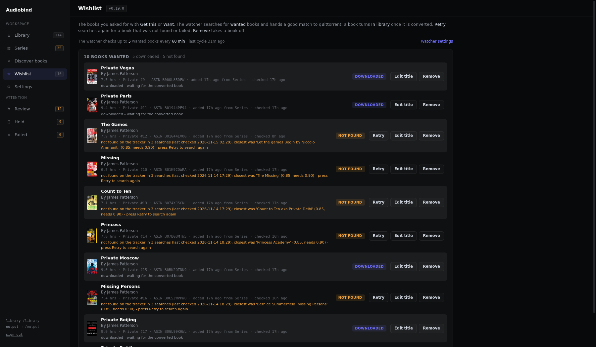
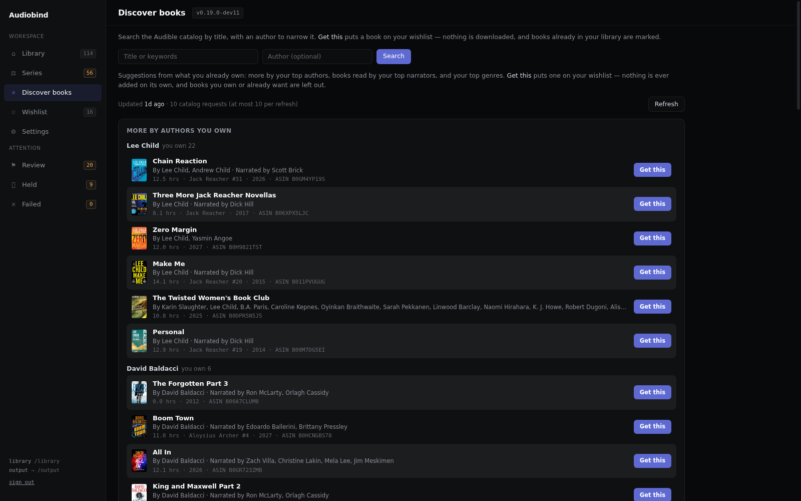

# Audiobind: using it

[← Back to the README](../README.md)

## Multipart books

Discovery can group siblings with matching names and distinct part numbers such as
`Part 1` and `Part 2`. The largest part can be up to six times the size of the smallest,
including the final part. This bound allows uneven rips and splits sets with a wider
spread. If part sizes are unavailable, discovery uses the names alone. Volume numbers
identify separate books.

## Controls in the web UI

The status page lists at most 400 books at a time. Typing in **Filter books** narrows the rows shown;
pressing Enter searches the whole library.

The status page is also the control panel:

| Button | What it does |
|---|---|
| **Scan for changes** | skips the interval and starts a pass immediately |
| **Pause after this book** | finishes the book in flight, then stops before starting another |
| **Resume** | continues, and scans immediately |
| **Preview library conversions** | switches between deciding-only and writing. Persisted, so a restart keeps your choice; `DRY_RUN=true` always starts dry, whatever was saved (the switch can turn it off afterwards), while `DRY_RUN=false` leaves the saved choice in charge |

Both toggles survive container restarts. Scripted equivalent:

```bash
AUTH="Authorization: Bearer $AUDIOBIND_PASSWORD"
curl -X POST -H "$AUTH" -H 'Content-Type: application/json' -d '{"action":"pause"}'    localhost:8080/api/control
curl -X POST -H "$AUTH" -H 'Content-Type: application/json' -d '{"action":"resume"}'   localhost:8080/api/control
curl -X POST -H "$AUTH" -H 'Content-Type: application/json' -d '{"action":"scan"}'     localhost:8080/api/control
curl -X POST -H "$AUTH" -H 'Content-Type: application/json' -d '{"action":"dry_run","value":false}' localhost:8080/api/control
```

Every POST must be sent as `Content-Type: application/json` (anything else gets a 415).
If the request carries an `Origin` or `Referer` header, it has to name this server's own
host, or `X-Forwarded-Host` when you're behind a reverse proxy. Anything else gets a 403. That
stops another website you visit from pressing these buttons for you. Scripts that send
neither header, like the `curl` lines above, keep working. They still need the Bearer
password (see [Signing in](install.md#signing-in)). Keep the port on your LAN all the same.

When an ASIN in your ingest folder name belongs to a different book from the suggested match,
the book’s detail panel names both titles.

Before adding a format or using Convert anyway, Audiobind checks the existing destination against
the file identities recorded for this book and edition. An output collision sends the book to
Review and leaves the existing files in place. This can happen with older records that lack file
identities, when an existing format came from another edition, or when a companion file that
would be replaced has changed. Inspect the named file and resolve the collision before retrying.

### Series

The **Series** tab (`/series`) lists every series you have a book of that Audible lists with two or more books, whether you own one or all of them.
Each one is checked against the Audible series order and shows what you're missing. The
amber number on the tab is the total missing across every series whose size Audible
reported. **I have this** marks a book you own without a rip, so it stops counting as
missing. **Copy Audible link** copies the book's Audible page address. Series lists are
fetched in the background, at most once a day per series. `/api/series` returns the same
data as JSON.

A book is shelved under the series its converted file is tagged with: the one Audnex lists for
it, or yours if you set a series in the book's panel. The panel and the Match column show the
same name, so they never disagree with the file. When Audnex lists no series for a book, the
series from the Audible search is shown instead, and the panel says so. The file is then
tagged without a series unless you set one.

Each card shows "owned X of Y" and notes that the total comes from the Audible catalog, with
when it was checked. While Audiobind looks up the series, the card says **Checking…**. If Audible has no
listing, it says **Unlisted on Audible**. If the lookup fails, the card tells you what to check. In the missing
list, **Add to wishlist** puts one book on your wishlist. **Want all missing** adds every missing book in
the series in one click. Books already on the wishlist are skipped, and nothing is downloaded.
Want all uses the server's current missing list, so a book you got after the page loaded isn't
added.

```bash
curl -X POST -H "$AUTH" -H 'Content-Type: application/json' \
     -d '{"series":"jack-reacher","missing":"all"}' localhost:8080/api/wishlist
```

### Discover and the wishlist

**Discover books** (`/discover`) is one screen: a search box on top and, below it, the
recommended books. Searching shows the results on the same page in place of the
recommendations; clearing the query brings the recommendations back. The search form takes a
title, with an optional author. Each result shows its cover, authors, narrators, runtime, series and release year.
Books already in your library are marked **In your library**: same ASIN, same title and
author, or marked "I have this" on the Series page. **Add to wishlist** puts a book on your
wishlist. That's all it does: nothing is downloaded, and no tracker is contacted. The
[wishlist watcher](acquisition.md#the-wishlist-watcher-private-tracker) picks books up from there when it is
on. The **Wishlist** tab (`/wishlist`, right below Discover books in the rail, watcher only) lists it with
each book's state and when it was last checked; **Retry** and **Remove** act on one book. The number
on the Wishlist tab is the wishlist size.



A wishlist row moves through these states: **wanted** → **downloading** (sent to qBittorrent) →
**downloaded** (the torrent finished; the book is waiting to be converted). The row is **removed**
when the converted book appears in your library (a want-list holds nothing you already have). A book
that is in your library already is taken off the list the same way, whatever its state. **not
found** and **error** rows stay until you press **Retry** or **Remove**.

**Edit title** gives a book its own *search title*. The watcher searches the tracker for that title
instead of the catalog one, and the match has to clear the same 0.90 title score against it. Use
it when a book comes back *not found* with a note like `closest was 'The Missing' (0.85, needs
0.90)`: the catalog calls it `Missing`, the tracker calls it `The Missing`, so type the tracker's title. Saving
puts the book back to *wanted* with its note and miss count cleared, so the next cycle searches
it at once; the row keeps its catalog title and shows `searching for "..."` while an override is
set. Saving a blank title clears the override. Search uses
one catalog request at a time, with the same pacing as matching, and only the US store
(`api.audible.com`).

```bash
curl -H "$AUTH" 'localhost:8080/api/discover/search?title=project+hail+mary&author=weir'
curl -H "$AUTH" localhost:8080/api/wishlist
curl -X POST -H "$AUTH" -H 'Content-Type: application/json' -d '{"asin":"B08G9PRS1K"}' localhost:8080/api/wishlist
curl -X POST -H "$AUTH" -H 'Content-Type: application/json' -d '{"asin":"B08G9PRS1K"}' localhost:8080/api/wishlist/remove
```

Adding an ASIN that's already on the list changes nothing. If Audiobind has never shown an
ASIN (in a search, a suggestion or a series), send `"title"` (and `"authors"`) with it.

The recommendations on Discover books suggest books based on what you already own. They have
three sections: more by your top 5 authors, books read by your top 3 narrators, and your top 2
genres. Genres come from the `metadata.json` written beside each published book. Books you own
or already want are left out, and so are summaries and other knockoffs. Suggestions are stored,
so opening the page doesn't query the catalog. A refresh runs when nothing is stored yet, when
the stored suggestions are more than 7 days old, or when you press **Refresh**. One refresh
makes at most 10 catalog requests (one per author, narrator and genre). Nothing goes on the
wishlist until you press **Add to wishlist**.



```bash
curl -H "$AUTH" localhost:8080/api/discover/recommendations          # stored result only
curl -X POST -H "$AUTH" -H 'Content-Type: application/json' \
     -d '{"action":"refresh","force":true}' localhost:8080/api/discover/recommendations
```

## CLI

```bash
docker exec audiobind audiobind audit              # report only, writes /config/audit.csv
docker exec audiobind audiobind scan               # one pass, convert what is safe
docker exec audiobind audiobind convert --unit "Michael Lewis- Moneyball"
docker exec audiobind audiobind daemon             # the default: scan forever
docker exec audiobind audiobind health             # exit 0 while the daemon is alive
docker exec -it audiobind audiobind reset-password # forgot the password: set a new one
```

The library header shows when the service last checked in and when a scan last finished.
The service can keep checking in while scanning is paused. Ingest availability is shown in the sidebar.

## Deleting a book

The confirmation describes what happens to the book in Audiobind, its source files and its converted copy.
Afterward, the message reports what actually happened to each. A read-only source stays in your library.

Delete checks the source paths, file sizes and modification times recorded during the book's audit.
If the source changed or the row predates that record, re-check the book before deleting it.
Delete removes symbolic links in the book folder without following them. It accepts a linked
parent inside the library and refuses paths that escape the library. Special entries such as
named pipes stay in place and are listed after the other source files are deleted.
A delete that detects a late arrival during staging restores the staged files and keeps the row.

If Audiobind cannot verify the published files of an older row, it lists the exact paths for a separate
confirmation. Declining that confirmation keeps those files. Removing an ingest row keeps its torrent
seeding and dismisses the row so scans skip it.

## Dismissing a publication quarantine

An interrupted publication that Audiobind cannot recover adds a note to the book. You can
release it using the authenticated `POST /api/unit` action `dismiss_publication_quarantine`
with the book's `path` and `"confirm": true`. First inspect the published files, backups and
staged files. Dismissing the quarantine leaves them all on disk and allows book operations
to resume, subject to the usual file ownership checks.

In the review queue, **View conversion error**, **Compare runtimes**, and **Check Audible match**
open the relevant part of the book's details. Choose another edition or edit overrides in those details.
